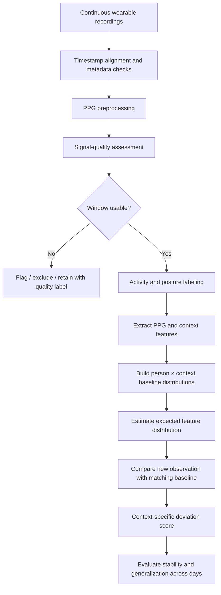
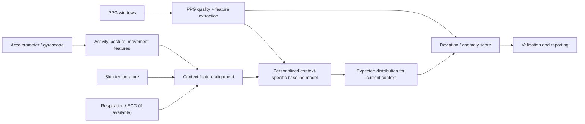

# Personalized Context-Specific Baselines for Continuous PPG

> **Research track 1:** Learn what a person's PPG typically looks like
> in each physical context (e.g., sitting, standing, sleeping, walking),
> rather than forcing every recording into one supposedly universal
> "pure" waveform.

[]()
[]()
[]()

## Table of contents

-   [1. Project overview](#1-project-overview)
-   [2. Research question and scope](#2-research-question-and-scope)
-   [3. Why context-specific
    baselines?](#3-why-context-specific-baselines)
-   [4. Scientific background](#4-scientific-background)
-   [5. What counts as a baseline?](#5-what-counts-as-a-baseline)
-   [6. Proposed research framework](#6-proposed-research-framework)
-   [7. Data requirements](#7-data-requirements)
-   [8. Recommended experimental
    protocol](#8-recommended-experimental-protocol)
-   [9. Signal-processing pipeline](#9-signal-processing-pipeline)
-   [10. PPG features](#10-ppg-features)
-   [11. Baseline-learning methods](#11-baseline-learning-methods)
-   [12. Evaluation and validation](#12-evaluation-and-validation)
-   [13. Experimental hypotheses](#13-experimental-hypotheses)
-   [14. Recommended analysis plan for a 10-day
    recording](#14-recommended-analysis-plan-for-a-10-day-recording)
-   [15. Dataset recommendations](#15-dataset-recommendations)
-   [16. Limitations and threats to
    validity](#16-limitations-and-threats-to-validity)
-   [17. Reproducibility and reporting
    checklist](#17-reproducibility-and-reporting-checklist)
-   [18. Suggested repository
    structure](#18-suggested-repository-structure)
-   [19. Research papers and
    resources](#19-research-papers-and-resources)
-   [20. Glossary](#20-glossary)
-   [21. Research boundaries and safety
    note](#21-research-boundaries-and-safety-note)

------------------------------------------------------------------------

## 1. Project overview

Photoplethysmography (PPG) is an optical technique that measures changes
in light absorption or reflection associated with blood-volume changes
in tissue. Wearable devices use PPG for measurements such as pulse rate
and, under suitable conditions, pulse-rate variability and waveform
morphology.

Continuous wearable PPG is not stationary. Its observed waveform changes
with:

-   Physical activity and movement.
-   Body posture and the height of the sensor relative to the heart.
-   Autonomic nervous system activity.
-   Respiration.
-   Skin and peripheral tissue temperature.
-   Local perfusion and vascular tone.
-   Sensor contact, strap tightness, and sensor displacement.
-   Ambient light, device hardware, wavelength, and signal-processing
    settings.

These influences are not all "noise." Some are measurement artifacts;
others are genuine physiological responses. This project focuses on
**Approach 1: personalized, context-specific PPG baselines**.

The central idea is to learn the expected distribution of PPG
characteristics for each context, for each individual. For example, a
person's sitting PPG should be compared with that person's sitting
baseline, while standing PPG should be compared with that person's
standing baseline.

### Main objective

Develop and evaluate a personalized baseline model:

\[ B\_{i,c} =
`\text{expected PPG feature distribution for person }`{=tex} i
`\text{ in context }`{=tex} c \]

where:

-   \(i\) identifies the participant.
-   \(c\) identifies a context such as sitting, standing, supine rest,
    sleep, or walking.
-   (B\_{i,c}) is a distribution or model, not necessarily one fixed
    waveform.

### What this project is --- and is not

**This project is:**

-   Context-aware PPG characterization.
-   Within-person baseline learning.
-   Personalized anomaly/deviation analysis.
-   A way to avoid comparing physiologically different contexts against
    one common baseline.
-   A framework that can incorporate activity, posture, temperature, and
    other contextual variables.

**This project is not:**

-   A claim that sleeping PPG is a perfect ground truth.
-   A universal PPG denoising solution.
-   A method for removing every activity-related physiological response.
-   A counterfactual reconstruction of what the signal would have been
    under another activity.
-   A diagnostic system.

------------------------------------------------------------------------

## 2. Research question and scope

### Primary research question

> Can personalized, context-specific PPG baselines better characterize
> normal within-person PPG variation across daily physical conditions
> than a single global baseline?

### Secondary questions

1.  How do PPG morphology and pulse-related features differ between
    sitting, standing, supine rest, sleep, and walking?
2.  How much within-context variation remains after controlling for
    signal quality?
3.  Does adding accelerometer-derived movement, posture, or skin
    temperature improve baseline estimation?
4.  Are context-specific baselines more useful than a single baseline
    for identifying unusual deviations?
5.  How stable are a person's baselines across days, time of day, and
    repeated sessions?
6.  How much data is needed to estimate a reliable baseline for each
    context?

### Scope for this repository

The first research track should answer the questions above without
trying to produce a universal "pure PPG." A separate research track can
investigate context removal or reference-condition/counterfactual
estimation.

------------------------------------------------------------------------

## 3. Why context-specific baselines?

A single PPG baseline can be misleading when the signal is collected
under different physiological conditions.

For example, a heart rate that is unusual while sitting may be expected
during walking. Similarly, posture and sensor height can alter PPG
quality and morphology even when the person is not moving much.

### Conceptual illustration


*Illustrative schematic only. The waveforms are not measured data and do
not represent universal morphology or clinical reference values.*

### Example: same person, different contexts

The table below uses **illustrative values only** to explain the
concept. It is not a clinical reference table and should not be used as
a target for model training.

  Feature                        Sitting   Standing   Sleeping
  ---------------------------- --------- ---------- ----------
  Heart rate                      72 bpm     84 bpm     58 bpm
  Normalized pulse amplitude        0.80       0.65       0.95
  Pulse width                     0.31 s     0.29 s     0.34 s
  Rise time                       0.12 s     0.11 s     0.14 s

A measurement should be interpreted relative to the appropriate context
and the person's own history. The values above merely illustrate why a
single threshold may not be appropriate.

### Advantages

1.  **Preserves genuine physiology.** An exercise-related increase in
    heart rate is not automatically classified as noise.
2.  **Improves contextual interpretation.** A sitting observation is
    compared with sitting observations, not with running or sleep.
3.  **Supports personalized deviation detection.** A change can be
    expressed relative to the person's own context-specific
    distribution.
4.  **Works with observational longitudinal data.** A 10-day recording
    may provide repeated examples of some contexts, subject to
    sufficient coverage and reliable labels.
5.  **Provides a foundation for future research.** Context-specific
    models can later support a separate reference-condition
    normalization study.

### Limitations

-   "Sitting" is not one homogeneous physiological state.
-   Recent exercise, stress, meals, medication, illness, ambient
    temperature, and time of day may change PPG while activity remains
    the same.
-   Some contexts may have too few valid windows to estimate a reliable
    baseline.
-   Baseline learning does not itself remove sensor artifacts.
-   A model may learn device-specific or participant-specific quirks
    rather than physiology.

------------------------------------------------------------------------

## 4. Scientific background

### 4.1 PPG reflects both physiology and measurement conditions

A simplified conceptual model is:

\[ P\_{`\mathrm{observed}`{=tex}}(t) = F`\left`{=tex}( H(t), A(t), S(t),
T(t), R(t), C(t), D `\right`{=tex}) + `\epsilon`{=tex}(t) \]

where:

-   (H(t)): underlying cardiovascular/autonomic state.
-   (A(t)): activity and movement context.
-   (S(t)): posture and sensor height relative to the heart.
-   (T(t)): skin/peripheral temperature.
-   (R(t)): respiration.
-   (C(t)): sensor contact/coupling.
-   (D): device properties (wavelength, LED intensity, geometry,
    sampling, firmware).
-   (`\epsilon`{=tex}(t)): unexplained measurement noise.

This is a conceptual representation, not a fully identified physical
equation. These variables interact and are not necessarily additive or
independent.

### 4.2 Separate measurement artifacts from physiological variation

  -----------------------------------------------------------------------
  Source                  Example                 Interpretation
  ----------------------- ----------------------- -----------------------
  Motion artifact         Wrist movement causes   Measurement
                          optical coupling        interference
                          changes                 

  Sensor displacement     Watch shifts on the     Measurement
                          wrist                   interference

  Contact-pressure change Strap is tightened or   Can alter measurement
                          loosened                and local physiology

  Postural response       Standing changes        Genuine physiology; may
                          hydrostatic pressure    also affect signal
                          and cardiovascular      quality
                          regulation              

  Exercise response       Heart rate and          Genuine physiology
                          peripheral circulation  
                          change during           
                          walking/running         

  Temperature response    Cooling can cause       Genuine physiology
                          peripheral              
                          vasoconstriction        

  Respiration             Pulse amplitude and     Genuine physiology
                          intervals vary across   
                          the respiratory cycle   

  Ambient                 Optical/electronic      Measurement
  light/electronic noise  interference            interference
  -----------------------------------------------------------------------

A key design rule is: **do not label every component correlated with
activity as an artifact.** Activity can simultaneously cause movement
artifact and a real cardiovascular response.

### 4.3 Sleep is useful, but not a perfect ground truth

Sleep can provide long periods with relatively little voluntary
movement, but it is not a universal ideal baseline:

-   Sleep stages have different autonomic and cardiovascular
    characteristics.
-   Heart rate and vascular tone change during the night.
-   Circadian rhythms affect physiology.
-   Sleep posture and wrist position influence the measurement.
-   A low-motion segment can still have poor sensor contact or other
    artifacts.

Treat sleep as a distinct context. If sleep-stage labels are available
and reliable, consider modeling sleep stages separately. Do not assume
all sleep windows are interchangeable.

### 4.4 Posture and sensor height matter

A 2025 study of wrist PPG in 1,142 participants found that measured
signal quality differed across supine, sitting, and standing postures
and with sensor height relative to the heart. In that study, signal
quality was highest in the supine position and lower in natural sitting
and standing positions. This is evidence that context-specific
signal-quality assessment is important; it does not mean supine PPG is
always physiologically "truer."

### 4.5 Temperature is a useful covariate, not a complete correction signal

Skin temperature may help explain changes in peripheral vascular tone
and perfusion. However, it cannot uniquely identify the cause or
magnitude of a PPG change. Temperature should be treated as one
contextual predictor alongside activity, posture, sensor quality, and
other available measurements.

------------------------------------------------------------------------

## 5. What counts as a baseline?

Avoid defining a baseline as one average waveform. A useful baseline is
a **personalized conditional distribution**.

For person (i), context (c), and feature (k):

\[ B\_{i,c,k} = `\left`{=tex}( `\mu`{=tex}*{i,c,k},
`\sigma`{=tex}*{i,c,k}, Q\_{i,c,k}, n\_{i,c,k} `\right`{=tex}) \]

where:

-   (`\mu`{=tex}): estimated central tendency (e.g., mean or median).
-   (`\sigma`{=tex}): variability (e.g., standard deviation or robust
    scale).
-   (Q): selected quantiles or empirical distribution.
-   (n): number of valid observations.

For skewed or outlier-prone features, median and median absolute
deviation (MAD) may be preferable to mean and standard deviation.

### Context hierarchy

Start with a small number of reliably identifiable contexts:

1.  Supine awake rest.
2.  Seated rest.
3.  Standing still.
4.  Walking.
5.  Sleep (optionally split by sleep stage if available).

Do not create many fine-grained categories until there is enough data in
each category.

### Activity and posture are different dimensions

A stronger representation may use separate labels:

-   **Activity:** resting, walking, running, cycling, household
    activity.
-   **Posture:** supine, seated, standing, unknown.
-   **Movement intensity:** continuous accelerometer-derived quantity.
-   **Sleep state:** awake/asleep and sleep stage if independently
    available.

For example, "sitting" is a posture, while "resting" is an
activity/state. A person can be seated while stressed, eating, working,
or recovering after exercise. Keep the label definitions explicit.

------------------------------------------------------------------------

## 6. Proposed research framework

### 6.1 High-level workflow



### 6.2 Model architecture



### 6.3 The output

For each valid window, the system should return at least:

-   Context label and confidence.
-   Signal-quality score and quality flags.
-   PPG features.
-   Expected baseline center and spread for that person/context.
-   Standardized deviation or percentile.
-   Baseline sample count and coverage.
-   A warning if the current context is underrepresented or outside the
    model's training range.

Do not return a confident deviation score when the context classifier is
uncertain or the baseline has too few valid observations.

------------------------------------------------------------------------

## 7. Data requirements

### Minimum useful signals

  -----------------------------------------------------------------------
  Signal                  Why it helps            Priority
  ----------------------- ----------------------- -----------------------
  PPG waveform            Primary measurement     Required

  Accelerometer           Movement intensity and  Strongly recommended
                          artifact context        

  Gyroscope               Orientation/rotation    Useful
                          context                 

  Skin temperature        Peripheral thermal      Useful
                          context                 

  ECG                     Independent cardiac     Strongly recommended
                          timing reference        for validation

  Respiration             Respiratory modulation  Optional

  EDA                     Arousal/sweating        Optional
                          context                 

  Contact pressure        Sensor coupling         Optional but valuable
                          information             
  -----------------------------------------------------------------------

If only PPG is available, this project can still characterize PPG
distributions by externally supplied activity labels, but it will be
harder to distinguish poor signal quality from genuine physiological
changes.

### Metadata to record

-   Participant pseudonymous ID.
-   Device model and firmware.
-   Sensor location and orientation.
-   PPG wavelength(s), if known.
-   Sampling rate and units.
-   Timestamp/time zone and synchronization method.
-   Activity and posture label source.
-   Label confidence and transition periods.
-   Skin temperature sensor location.
-   Known device removals, charging periods, and missing data.
-   Relevant protocol annotations (e.g., meals, exercise, sleep, if
    ethically and appropriately collected).

Do not place names, email addresses, exact birth dates, or other direct
identifiers in a public repository.

------------------------------------------------------------------------

## 8. Recommended experimental protocol

### 8.1 Observational phase: use the 10-day recording

1.  Inspect timestamps, missing intervals, sampling rates, clipping, and
    device-off periods.
2.  Confirm whether activity/posture labels exist and how they were
    generated.
3.  Synchronize signals using timestamps; do not assume sample indices
    align.
4.  Segment into windows. A starting experiment could compare 10 s, 20
    s, and 30 s windows; the best window depends on sampling rate and
    target feature.
5.  Detect transitions and avoid assigning mixed-activity windows to a
    stable context.
6.  Compute signal-quality measures and retain quality labels.
7.  Build baseline distributions only from windows that meet
    pre-specified quality criteria.
8.  Quantify how many independent valid minutes/windows exist per
    context and per day.

### 8.2 Controlled repeatability phase (recommended)

If feasible, collect repeated sessions from the same participant:

-   Awake supine rest.
-   Seated rest.
-   Standing still.
-   Controlled walking.
-   Recovery after walking.

Record synchronized PPG and accelerometry, and ideally ECG and skin
temperature. Standardize sensor placement, strap fit, arm position, and
rest/recovery periods. Randomize the order of posture/activity blocks
when practical, and document protocol deviations.

Repeat sessions on multiple days. This helps estimate within-person
repeatability and day-to-day drift.

### 8.3 Example protocol table

  Block   Condition             Suggested recording Notes
  ------- ------------------- --------------------- ------------------------------------
  1       Supine awake rest               5--10 min Distinguish from sleep
  2       Seated rest                     5--10 min Record arm/sensor height
  3       Standing still                  5--10 min Record arm position
  4       Walking                         5--10 min Record speed/intensity if possible
  5       Recovery seated                 5--10 min Record time since activity

These durations are practical starting points, not universal standards.
Adapt them to the device, study design, and ethics approval.

------------------------------------------------------------------------

## 9. Signal-processing pipeline

### 9.1 Preserve the raw data

Never overwrite raw recordings. Keep immutable raw files and store
processed data separately with versioned configuration.

### 9.2 Preprocessing

A candidate pipeline:

1.  Validate sampling frequency and timestamp monotonicity.
2.  Detect missing samples and discontinuities.
3.  Remove or flag saturation/clipping.
4.  Apply a documented filter appropriate to the target feature and
    sampling rate.
5.  Detect pulse candidates.
6.  Calculate signal-quality indices.
7.  Flag motion-corrupted windows.
8.  Extract features only from valid or explicitly quality-stratified
    windows.

Filter settings must be reported. There is no one filter that is optimal
for every PPG task. A filter that is acceptable for pulse-rate
estimation may distort morphology or pulse timing.

### 9.3 Signal-quality assessment

Possible measures:

-   Template beat correlation.
-   Beat-to-beat morphology consistency.
-   Perfusion index (with device-specific caveats).
-   Signal-to-noise or spectral quality measures.
-   Pulse detection confidence.
-   Accelerometer activity level.
-   Clipping and flatline detection.

Signal-quality indices are imperfect. Evaluate them against manually
reviewed segments or an independent reference where possible.

### 9.4 Motion artifact handling

Possible methods include:

-   Exclude severely corrupted windows.
-   Adaptive noise cancellation using accelerometer reference channels.
-   Signal decomposition or time-frequency methods.
-   PPG-specific quality models.
-   Machine-learning models trained against a reference signal.

For this first approach, artifact correction is a
preprocessing/quality-control stage, not the primary research claim.
Compare at least: - No artifact correction (quality flags only). -
Quality-based exclusion. - A chosen artifact-correction method, if
reference channels and validation data are available.

Do not assume an accelerometer can remove all activity effects. It can
help identify motion, but it cannot tell you that a true
exercise-induced heart-rate change is noise.

------------------------------------------------------------------------

## 10. PPG features

Start with a small, interpretable feature set. Add more only after
checking reliability.

  -----------------------------------------------------------------------
  Feature                 Meaning                 Caution
  ----------------------- ----------------------- -----------------------
  Pulse rate              Pulses per minute       Not identical to ECG HR
                                                  in every condition

  Inter-pulse interval    Time between PPG pulse  Sensitive to pulse
                          fiducials               detection errors

  Pulse amplitude         Peak-to-foot or AC      Strongly affected by
                          amplitude               contact, perfusion,
                                                  gain, and temperature

  Pulse width             Width at a defined      Requires stable beat
                          relative amplitude      segmentation

  Rise time               Foot-to-systolic peak   Morphology and
                          time                    sampling-rate dependent

  Pulse area              Integrated pulse above  Sensitive to baseline
                          baseline                correction

  Slope features          Upstroke/downstroke     Noise-sensitive
                          characteristics         

  Template correlation    Similarity to           Can reward overly
                          personal/context        repetitive signals
                          template                

  Perfusion index         AC/DC ratio, depending  Device and
                          on device               implementation
                                                  dependent

  HRV/PRV metrics         Beat interval           PPG-derived PRV is not
                          variability             interchangeable with
                                                  ECG HRV in all settings
  -----------------------------------------------------------------------

### Feature extraction rules

-   Define the pulse foot and systolic peak algorithm explicitly.
-   Report units and normalization.
-   Do not mix features from different wavelengths or devices without
    calibration/analysis.
-   Evaluate feature repeatability within stable reference blocks.
-   Keep signal-quality metrics separate from physiological features.
-   Consider both raw amplitude and normalized morphology features;
    normalization can remove useful amplitude information.

### Window length

Evaluate multiple windows (e.g., 10, 20, and 30 seconds) rather than
assuming one is best. Short windows provide more frequent estimates but
may contain too few beats for stable morphology statistics. Longer
windows may mix transitions or changing conditions.

------------------------------------------------------------------------

## 11. Baseline-learning methods

Begin with transparent statistical baselines before deep learning.

### 11.1 Robust per-person, per-context baseline

For participant (i), context (c), feature (k), and valid windows (j):

\[ `\mu`{=tex}*{i,c,k} = `\operatorname{median}`{=tex}(x*{i,c,k,j}) \]

\[ MAD\_{i,c,k} = `\operatorname{median}`{=tex}`\left`{=tex}(
\|x\_{i,c,k,j}-`\mu`{=tex}\_{i,c,k}\| `\right`{=tex}) \]

A robust standardized deviation can be calculated as:

\[ z\_{i,c,k} = `\frac{x_{i,c,k}-\mu_{i,c,k}}`{=tex} {1.4826
`\cdot `{=tex}MAD\_{i,c,k}+`\varepsilon`{=tex}} \]

The factor 1.4826 makes MAD comparable to standard deviation for
normally distributed data. It does not make the feature normally
distributed. If MAD is zero or the sample count is low, do not produce
an unqualified z-score; use quantiles, a fallback scale, or mark the
estimate unavailable.

### 11.2 Empirical distributions and quantiles

For each person/context/feature, estimate:

-   Median.
-   5th, 25th, 75th, and 95th percentiles (if sample size supports
    them).
-   Interquartile range.
-   Number of valid windows.
-   Number of recording days represented.

Quantile baselines avoid assuming normally distributed features.

### 11.3 Context-conditioned regression

A more flexible extension predicts expected features from context:

\[ `\hat{Y}`{=tex}\_{i,k} =
f_i(`\text{activity}`{=tex},`\text{posture}`{=tex},`\text{temperature}`{=tex},
`\text{movement}`{=tex},`\text{time of day}`{=tex}) \]

Possible models:

-   Linear or robust regression.
-   Generalized additive models.
-   Random Forest.
-   Gradient-boosted trees (e.g., XGBoost/LightGBM).
-   Mixed-effects models.

For this research track, context-conditioned regression should remain an
extension of the baseline idea, not a move into counterfactual
normalization.

### 11.4 Hierarchical models

If multiple participants are available, consider a hierarchical model:

\[ Y\_{i,c} = `\beta`{=tex}\_0 + u_i + `\beta`{=tex}*c + u*{i,c} +
`\epsilon`{=tex} \]

where (u_i) represents participant-specific variation and (u\_{i,c})
participant-by-context variation. This can partially pool information
across people while retaining personalized baselines.

For one participant with 10 days of data, a population-level
hierarchical model cannot be estimated reliably from that participant
alone.

### 11.5 Deep learning: only after a statistical baseline

Possible later models:

-   CNN or temporal convolutional network for waveform embeddings.
-   LSTM/GRU for sequential context.
-   Transformer for longer temporal dependencies.
-   Contrastive/self-supervised learning for within-context
    representation learning.

Deep models need enough participants and independent sessions. With one
person and 10 days, a large neural network is likely to overfit. Use
simple models first.

------------------------------------------------------------------------

## 12. Evaluation and validation

### 12.1 What should be evaluated?

**A. Baseline stability**

-   Day-to-day change in baseline center.
-   Within-context variability.
-   Between-context separability.
-   Repeatability across controlled sessions.
-   Baseline coverage (how many windows/days support it).

**B. Context classification quality**

If activity/posture labels are inferred from sensors, report: - Accuracy
and macro-F1. - Confusion matrix. - Per-class precision/recall. -
Transition detection performance. - Confidence calibration, if
probabilities are used.

Incorrect context labels contaminate context-specific baselines.

**C. Feature reliability**

-   Beat detection error against ECG where appropriate.
-   Feature repeatability across repeated stable sessions.
-   Missing/invalid feature rate.
-   Sensitivity to window length and filter choice.

**D. Personalized deviation detection**

If an independent reference or carefully defined event labels exist: -
Sensitivity and specificity. - Precision/recall and PR-AUC. - False
alarms per hour/day. - Detection delay. - Calibration and uncertainty.

Do not claim clinical anomaly detection without appropriate clinical
labels and validation.

### 12.2 Compare against meaningful baselines

At minimum, compare:

1.  **Global baseline:** one personal distribution across all contexts.
2.  **Context-specific baseline:** one distribution per context.
3.  **Context + quality stratification:** context-specific baselines
    using only high-quality windows or quality strata.
4.  **Context-conditioned regression:** expected feature conditioned on
    activity, posture, and available covariates.

This directly tests whether context separation adds value.

### 12.3 Data leakage prevention

This is critical.

-   Split by day/session, not by randomly shuffling overlapping windows.
-   Keep windows from the same continuous episode in one split.
-   If multiple participants are available, also report
    leave-one-subject-out or subject-independent evaluation.
-   Fit scalers, feature selection, and baseline distributions using
    training data only.
-   Do not use future data to build a baseline when evaluating
    prospective monitoring.
-   Use a warm-up/calibration period and evaluate on later days where
    possible.

For a single-person 10-day study, a chronological split (e.g., early
days for baseline estimation, later days for evaluation) is more
realistic than random window splitting. Test multiple split points if
feasible.

### 12.4 Avoid a misleading success criterion

Lower variance is not automatically better. A model that suppresses all
variation can look stable while destroying real physiology.

A successful context-specific baseline should: - Improve comparison
within equivalent contexts. - Preserve expected differences between
contexts. - Be stable across repeated comparable sessions. - Maintain
agreement with independent physiological references where available. -
Report uncertainty and insufficient-data cases.

------------------------------------------------------------------------

## 13. Experimental hypotheses

The following are testable hypotheses, not established findings.

**H1 --- Context separation:** PPG feature distributions differ across
at least some physical contexts within an individual.

**H2 --- Context-specific comparison:** A context-specific baseline
produces more meaningful within-context deviation scores than one global
baseline.

**H3 --- Quality control:** Excluding or down-weighting severely
corrupted windows improves baseline stability.

**H4 --- Multimodal context:** Accelerometer-derived movement and
posture features improve context assignment and/or baseline prediction
compared with activity labels alone.

**H5 --- Thermal covariate:** Skin temperature explains additional
within-context variation in selected PPG features after accounting for
activity and posture.

**H6 --- Temporal stability:** Baselines vary across days and time of
day, so a static baseline may be less appropriate than a rolling or
time-aware baseline.

Each hypothesis should have a pre-defined outcome measure and
statistical test. Avoid testing many features without accounting for
multiple comparisons.

------------------------------------------------------------------------

## 14. Recommended analysis plan for a 10-day recording

### Phase 1 --- Data audit

Create a data inventory:

  Check                           Result to record
  ------------------------------- ------------------
  PPG device and location         
  PPG sampling rate               
  PPG wavelength(s)               
  Accelerometer sampling rate     
  Temperature availability/rate   
  ECG availability/rate           
  Timestamp/time zone             
  Activity labels                 
  Posture labels                  
  Missing data percentage         
  Device removal periods          

### Phase 2 --- Context coverage

For each context, calculate:

-   Total recorded duration.
-   Total valid duration after quality control.
-   Number of valid windows.
-   Number of distinct days.
-   Number of separate episodes.
-   Distribution of time of day.
-   Context-label confidence.

Do not build a baseline for a context represented by only a handful of
highly correlated windows.

### Phase 3 --- Exploratory analysis

Generate:

1.  PPG traces for representative windows in each context.
2.  Feature distributions by context.
3.  Daily feature trends.
4.  Signal-quality distributions by context.
5.  Activity intensity versus PPG feature plots.
6.  Temperature versus PPG feature plots.
7.  Context transition plots.

Use participant-level plots and report the number of observations behind
each summary.

### Phase 4 --- Baseline models

Implement in this order:

1.  Global robust baseline.
2.  Per-context robust baseline.
3.  Per-context baseline with quality filtering.
4.  Context-conditioned regression.
5.  Hierarchical or deep-learning model only if the dataset supports it.

### Phase 5 --- Evaluation

-   Use chronological held-out days.
-   Compare global and context-specific models.
-   Test sensitivity to window length and quality threshold.
-   Report uncertainty and sample coverage.
-   Repeat with different valid baseline calibration periods.

### Practical decision rule

If there are too few high-quality examples for a context, mark that
baseline as **insufficient data**. Do not silently borrow another
context's baseline and label it as the same condition.

------------------------------------------------------------------------

## 15. Dataset recommendations

### 15.1 PPG-DaLiA --- best starting public dataset

-   15 participants.
-   Wrist Empatica E4: BVP/PPG at 64 Hz, accelerometer at 32 Hz, EDA at
    4 Hz, temperature at 4 Hz.
-   Chest RespiBAN: ECG, respiration, and three-axis acceleration at 700
    Hz.
-   Daily activities include sitting still, stair climbing, table
    soccer, cycling, driving, lunch break, walking, and working.
-   ECG supports independent heart-rate ground truth.

**Important limitation:** The protocol does not provide every context
you may want. It is not a dedicated sleep/standing/running dataset.
Verify the activity labels and signal alignment in the original files
before analysis.

Links: - [UCI dataset
page](https://archive.ics.uci.edu/dataset/495/ppg+dalia) - [Original
dataset page](https://kristofvl.github.io/usi/data_ppgdalia.html) -
[Original paper](https://pmc.ncbi.nlm.nih.gov/articles/PMC6679242/)

### 15.2 WESAD

A multimodal wearable dataset designed for stress and affect research.
It includes BVP, ECG, accelerometry, temperature, EDA, respiration, and
other signals. It can help study physiological variation associated with
stress, but it is not a comprehensive activity/posture baseline dataset.

-   [WESAD project and
    dataset](https://ubicomp.eti.uni-siegen.de/home/datasets/icmi18/)

### 15.3 Aurora-BP

The 2025 wrist-PPG signal-quality determinants study used the Aurora-BP
dataset to investigate posture and sensor height. Access may require
approval.

-   [Study and dataset
    information](https://pmc.ncbi.nlm.nih.gov/articles/PMC12204546/)
-   [Analysis
    code](https://github.com/peterhcharlton/PPG_quality_determinants)

### Dataset selection advice

Use PPG-DaLiA to prototype multimodal activity-aware processing. Use
your own 10-day data for personalized longitudinal baseline development.
If you need sleep, standing, and controlled posture comparisons, plan a
supplementary protocol or find a dataset that explicitly contains those
conditions.

------------------------------------------------------------------------

## 16. Limitations and threats to validity

1.  **Single participant:** A 10-day recording can support a
    personalized case study, but cannot establish population-wide
    generalizability.
2.  **Label errors:** Activity and posture misclassification can
    contaminate baselines.
3.  **Confounding:** Time of day, meals, stress, medication, illness,
    ambient temperature, and recent exercise may vary with context.
4.  **Sensor effects:** Device model, LED wavelength, fit, wrist
    location, skin properties, and firmware affect the measured
    waveform.
5.  **Autocorrelation:** Adjacent windows are not independent
    observations. The effective sample size is smaller than the raw
    window count.
6.  **Context heterogeneity:** "Sitting" and "sleeping" each contain
    multiple physiological states.
7.  **Sleep-stage uncertainty:** Sleep labels from consumer devices may
    be imperfect; treat them as estimates, not definitive ground truth.
8.  **Feature validity:** PPG morphology features can be sensitive to
    filtering, sampling rate, pulse segmentation, and signal quality.
9.  **PRV versus HRV:** Pulse intervals are affected by pulse transit
    and vascular factors; PPG-derived PRV is not always interchangeable
    with ECG-derived HRV.
10. **No causal claim from correlation:** A temperature or activity
    association does not prove that the variable caused the PPG change.
11. **Baseline drift:** A person's physiology and device fit may change
    over 10 days or longer.
12. **Over-normalization:** A baseline model should not erase meaningful
    physiological changes.

------------------------------------------------------------------------

## 17. Reproducibility and reporting checklist

Before publishing results, report:

-   [ ] Device, sensor site, wavelength, sampling rate, and firmware (if
    known).
-   [ ] Participant count and relevant non-identifying cohort
    description.
-   [ ] Recording duration and protocol.
-   [ ] Exact definitions of activity and posture classes.
-   [ ] Label source and confidence.
-   [ ] Synchronization method and clock handling.
-   [ ] Filtering and preprocessing parameters.
-   [ ] Signal-quality criteria and excluded-data percentage.
-   [ ] Window length, overlap, and transition handling.
-   [ ] Feature definitions and units.
-   [ ] Baseline estimator and minimum sample threshold.
-   [ ] Train/validation/test split strategy.
-   [ ] Leakage prevention.
-   [ ] Metrics, confidence intervals, and uncertainty reporting.
-   [ ] Missing-data handling.
-   [ ] Code, configuration, and environment versions.
-   [ ] Dataset licenses and participant consent/ethics requirements.

------------------------------------------------------------------------

## 18. Suggested repository structure

``` text
ppg-context-baselines/
├── README.md
├── LICENSE
├── CITATION.cff
├── requirements.txt
├── configs/
│   ├── preprocessing.yaml
│   ├── contexts.yaml
│   └── baseline.yaml
├── data/
│   ├── README.md
│   ├── raw/                 # Not committed; private/ignored
│   ├── interim/
│   └── processed/
├── docs/
│   ├── protocol.md
│   ├── feature_definitions.md
│   └── analysis_plan.md
├── notebooks/
│   ├── 01_data_audit.ipynb
│   ├── 02_context_coverage.ipynb
│   ├── 03_signal_quality.ipynb
│   ├── 04_feature_extraction.ipynb
│   ├── 05_context_baselines.ipynb
│   └── 06_evaluation.ipynb
├── src/
│   ├── io/
│   ├── preprocessing/
│   ├── quality/
│   ├── context/
│   ├── features/
│   ├── baselines/
│   └── evaluation/
├── tests/
├── results/
│   ├── figures/
│   └── tables/
└── assets/
    └── context_baselines.svg
```

Suggested `.gitignore` entries:

``` gitignore
data/raw/
data/interim/
data/processed/
results/
*.pkl
*.mat
*.h5
*.hdf5
*.parquet
.ipynb_checkpoints/
__pycache__/
.venv/
.env
```

Do not upload identifiable physiological data or raw participant
recordings to a public GitHub repository without appropriate consent,
ethics approval, and data-sharing permission.

------------------------------------------------------------------------

## 19. Research papers and resources

The papers below are selected for the first research track: wearable
PPG, signal quality, activity/motion, posture, and multimodal context.
They provide background and methods; they do **not** all directly
propose personalized context-specific baselines.

### Core reviews and foundations

1.  **Charlton et al. (2022). "Photoplethysmogram Analysis and
    Applications: An Integrative Review."**
    -   Broad review of PPG generation, morphology, features, noise,
        preprocessing, and analysis.
    -   [PubMed](https://pubmed.ncbi.nlm.nih.gov/35300400/)
2.  **"Wearable Photoplethysmography for Cardiovascular Monitoring"
    (2020).**
    -   Review of wearable PPG, measurement challenges, motion
        artifacts, and cardiovascular applications.
    -   [Full text
        (PMC)](https://pmc.ncbi.nlm.nih.gov/articles/PMC7612541/)
3.  **Ismail, Akram & Siddiqi (2021). "Heart rate tracking in
    photoplethysmography signals affected by motion artifacts: a
    review."**
    -   Reviews motion-artifact removal and heart-rate tracking
        approaches, including adaptive filtering and multiresolution
        methods.
    -   [Springer Open
        Access](https://link.springer.com/article/10.1186/s13634-020-00714-2)
4.  **Seok et al. (2021). "Motion Artifact Removal Techniques for
    Wearable EEG and PPG Sensor Systems."**
    -   Review of artifact-removal approaches in wearable EEG/PPG
        systems.
    -   [Frontiers](https://www.frontiersin.org/journals/electronics/articles/10.3389/felec.2021.685513/full)

### Activity and multimodal datasets

5.  **Reiss et al. (2019). "Deep PPG: Large-Scale Heart Rate Estimation
    with Convolutional Neural Networks." Sensors, 19(14), 3079.**
    -   Introduces PPG-DaLiA and evaluates PPG plus synchronized
        accelerometer information for heart-rate estimation.
    -   [Full text
        (PMC)](https://pmc.ncbi.nlm.nih.gov/articles/PMC6679242/)
    -   [DOI](https://doi.org/10.3390/s19143079)
    -   [Dataset
        page](https://archive.ics.uci.edu/dataset/495/ppg+dalia)
6.  **WESAD: A Multimodal Dataset for Wearable Stress and Affect
    Detection.**
    -   Useful for studying stress-related physiological context and
        multimodal wearable signals.
    -   [Dataset and project
        page](https://ubicomp.eti.uni-siegen.de/home/datasets/icmi18/)

### Posture and physiological context

7.  **Charlton et al. (2025). "Determinants of photoplethysmography
    signal quality at the wrist." PLOS Digital Health.**
    -   Studies wrist PPG signal quality across supine, sitting, and
        standing postures and different sensor heights, using data from
        1,142 participants.
    -   [Full text
        (PMC)](https://pmc.ncbi.nlm.nih.gov/articles/PMC12204546/)
    -   [DOI](https://doi.org/10.1371/journal.pdig.0000585)
    -   [Related analysis
        code](https://github.com/peterhcharlton/PPG_quality_determinants)
8.  **Yuan et al. (2017). "An Experimental Study of the Effects of
    External Physiological Parameters on the Photoplethysmography
    Signals in the Context of Local Blood Pressure (Hydrostatic Pressure
    Changes)." Sensors, 17(3), 556.**
    -   Examines body position, breathing, applied pressure, motion, and
        local blood-pressure/hydrostatic effects on PPG.
    -   [Full text
        (PMC)](https://pmc.ncbi.nlm.nih.gov/articles/PMC5375842/)
    -   [DOI](https://doi.org/10.3390/s17030556)
9.  **"Insights into vascular physiology from sleep
    photoplethysmography" (2023).**
    -   Relevant to the decision to treat sleep as its own context
        rather than a perfect universal baseline.
    -   [PubMed](https://pubmed.ncbi.nlm.nih.gov/37379483/)

### How to use this literature

-   Start with papers 1--4 to understand PPG and signal quality.
-   Read paper 5 while exploring PPG-DaLiA.
-   Use papers 7--8 to motivate explicit posture and sensor-height
    labels.
-   Use paper 9 to justify treating sleep as a distinct physiological
    context.
-   Position the proposed work as personalized context-specific baseline
    learning, not as a claim that these papers already solve that exact
    problem.

------------------------------------------------------------------------

## 20. Glossary

  -----------------------------------------------------------------------
  Term                                Definition
  ----------------------------------- -----------------------------------
  PPG                                 Photoplethysmography; optical
                                      measurement related to changes in
                                      blood volume in tissue

  BVP                                 Blood volume pulse; commonly used
                                      label for wearable PPG-derived
                                      signals

  Context                             Activity, posture, sleep state, or
                                      environmental/physiological
                                      condition

  Baseline                            Personalized expected distribution
                                      of a feature in a defined context

  SQI                                 Signal-quality index

  SNR                                 Signal-to-noise ratio

  PI                                  Perfusion index; often based on
                                      pulsatile/non-pulsatile signal
                                      components

  PRV                                 Pulse-rate variability derived from
                                      pulse intervals

  HRV                                 Heart-rate variability,
                                      conventionally derived from ECG R-R
                                      intervals

  Within-person variation             Variation observed in the same
                                      individual over time

  Context-specific deviation          Difference between an observation
                                      and the expected distribution for
                                      its context

  Leakage                             Information from evaluation data
                                      inadvertently used during model
                                      fitting

  Autocorrelation                     Statistical dependence between
                                      nearby time samples/windows
  -----------------------------------------------------------------------

------------------------------------------------------------------------

## 21. Research boundaries and safety note

This is a research framework, not a medical device or diagnostic method.
A context-specific deviation is not, by itself, evidence of disease.
Clinical interpretation requires appropriate validation, reference
measurements, and expert oversight.

The most important scientific boundary is:

> **A context-specific baseline explains what is typical in a context;
> it does not make the observed signal free of all contextual effects.**

The first project should learn and validate personalized baselines. A
separate project can investigate whether selected PPG features can be
normalized to a defined reference condition. Keeping these research
questions separate makes the assumptions, evaluation targets, and claims
much clearer.

------------------------------------------------------------------------

## Citation

If you use or adapt this repository in academic work, cite the
underlying datasets and papers, and add a project citation once a formal
publication or release is available. Do not cite this README as evidence
for physiological claims; cite the original research papers.

**Suggested first milestone:** Audit the 10-day dataset, quantify valid
data coverage per context, and build a robust median/MAD baseline for a
small set of PPG features. Compare it with a single global baseline
using a chronological held-out evaluation.
