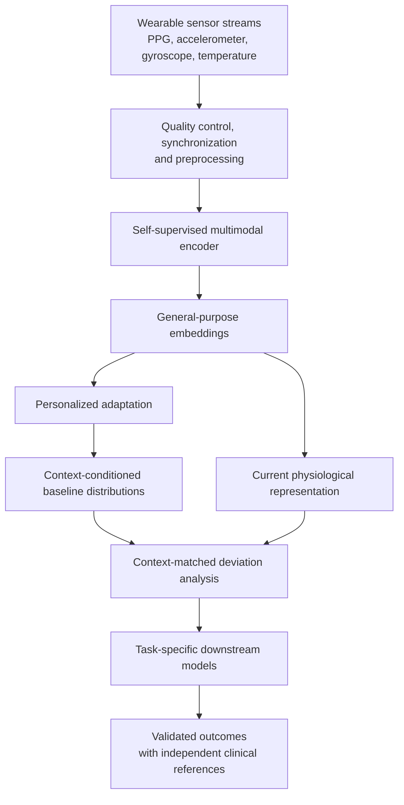
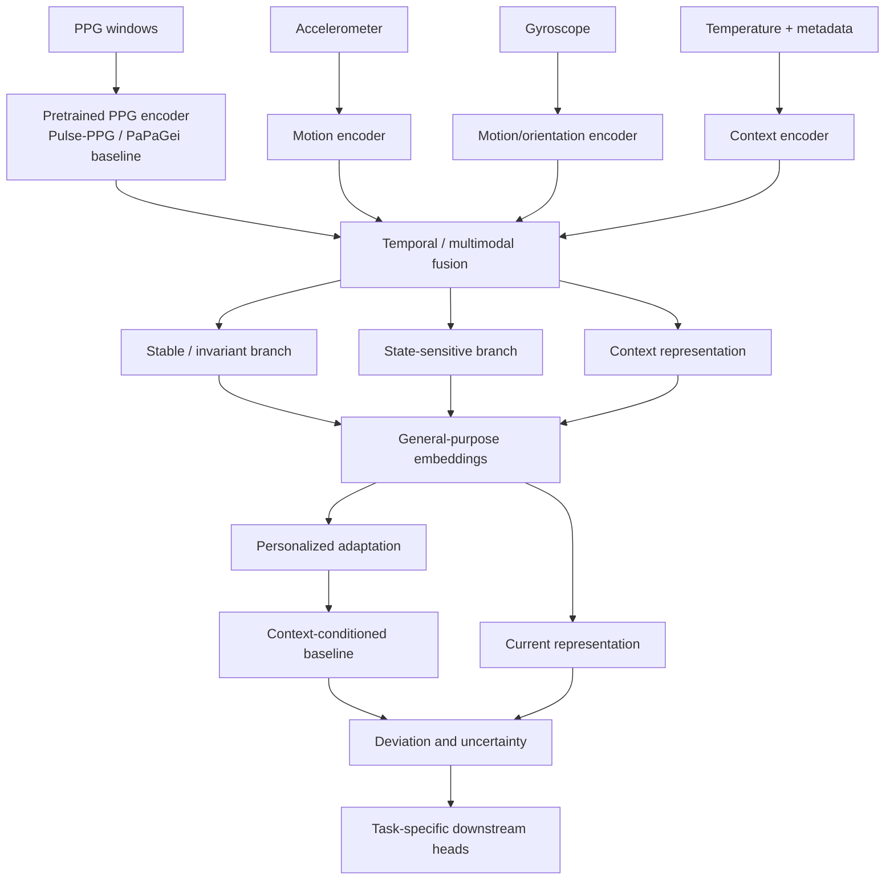

# Personalized Multimodal Physiological Foundation Model (PMP-FM)

### A self-supervised framework for personalized physiological representation learning and disease-associated change detection using wearable sensors

[](#project-status)
[](#data-and-sensors)
[](#proposed-self-supervised-pretraining)
[](#data-and-sensors)

**Project type:** Research proposal and experimental roadmap\
**Working name:** PMP-FM\
**Primary signal:** Photoplethysmography (PPG)\
**Additional signals:** Accelerometer, gyroscope, skin temperature, and
optional device-quality metadata\
**Intended outputs:** General-purpose wearable embeddings, personalized
baselines, context-aware deviation scores, and validated task-specific
predictions

> **Research status and safety statement:** PMP-FM is a proposed
> research framework, not an established diagnostic system. A change in
> PPG or an embedding is not proof of disease. Glucose estimation,
> diabetes screening, blood-pressure estimation, arrhythmia detection,
> and other clinical applications require independent reference
> measurements, rigorous subject-independent validation, clinical
> oversight, and appropriate regulatory review. Do not use this proposal
> to guide medication, diagnosis, or unsupervised glucose challenges.

------------------------------------------------------------------------

## Table of contents

1.  [Project overview](#1-project-overview)
2.  [Research motivation](#2-research-motivation)
3.  [Research questions and
    hypotheses](#3-research-questions-and-hypotheses)
4.  [Scope and terminology](#4-scope-and-terminology)
5.  [Data and sensors](#5-data-and-sensors)
6.  [Related work and open-source
    resources](#6-related-work-and-open-source-resources)
7.  [Proposed PMP-FM architecture](#7-proposed-pmp-fm-architecture)
8.  [Self-supervised pretraining
    objectives](#8-self-supervised-pretraining-objectives)
9.  [Personalized physiological baseline
    modeling](#9-personalized-physiological-baseline-modeling)
10. [Downstream tasks: glucose example and
    beyond](#10-downstream-tasks-glucose-example-and-beyond)
11. [Datasets and data acquisition](#11-datasets-and-data-acquisition)
12. [Preprocessing and windowing](#12-preprocessing-and-windowing)
13. [Experimental plan and
    ablations](#13-experimental-plan-and-ablations)
14. [Evaluation protocol and
    metrics](#14-evaluation-protocol-and-metrics)
15. [Implementation roadmap](#15-implementation-roadmap)
16. [Reproducibility, ethics, and
    limitations](#16-reproducibility-ethics-and-limitations)
17. [Proposed repository structure](#17-proposed-repository-structure)
18. [Expected contributions](#18-expected-contributions)
19. [Figures and visual references](#19-figures-and-visual-references)
20. [References and useful links](#20-references-and-useful-links)

------------------------------------------------------------------------

## 1. Project overview

PMP-FM investigates whether a self-supervised model can learn useful
representations from continuous, multimodal smartwatch recordings and
whether those representations can be personalized to an individual's
longitudinal physiological baseline.

The central idea is to separate three related but different learning
problems:

1.  **General physiological representation learning:** Learn reusable
    features from large amounts of unlabeled PPG and wearable sensor
    data.
2.  **Personalized baseline modeling:** Learn what is typical for a
    particular individual under a particular activity and context.
3.  **Clinical outcome modeling:** Use independently measured clinical
    outcomes to train and validate task-specific models that interpret
    physiological changes.

A motivating example is a standardized, clinically supervised glucose
challenge. A participant's PPG embeddings before and after the
intervention may differ. The research question is not simply whether the
embedding changes, but whether the change is reproducible, exceeds
expected within-person variation, remains after accounting for activity,
temperature, sensor quality and other confounders, and is associated
with independently measured glucose values.

The same reusable representation and baseline framework could be
evaluated for other outcomes, provided suitable reference labels and
datasets exist.

### High-level workflow



------------------------------------------------------------------------

## 2. Research motivation

### 2.1 Why PPG?

Photoplethysmography is an optical technique that measures changes in
peripheral blood volume. Consumer wearables commonly use PPG for
heart-rate monitoring. The waveform also contains pulse morphology,
amplitude, timing, and temporal information that may be relevant to
cardiovascular and autonomic physiology.

However, PPG is affected by multiple factors:

-   Physical activity and movement artifacts.
-   Sleep, wakefulness, posture, and recovery.
-   Skin and ambient temperature.
-   Peripheral vascular tone and perfusion.
-   Stress and autonomic state.
-   Sensor placement, contact pressure, LED wavelength, gain, and device
    design.
-   Individual characteristics and within-person day-to-day variation.

Therefore, a PPG waveform should not be interpreted independently of its
recording context.

### 2.2 Why personalized baselines?

A population reference may not adequately represent an individual's
normal physiology. Two healthy people can have different resting heart
rates and pulse morphology. A single person's PPG can also change
substantially between sleep, rest, exercise, and environmental
conditions.

PMP-FM therefore investigates conditional, individual-specific baselines
rather than one universal waveform or one fixed threshold.

### 2.3 Why self-supervised learning?

Clinical labels are expensive, incomplete, and difficult to collect at
the scale needed for foundation-model pretraining. Wearables can
generate large amounts of unlabeled data. Self-supervised learning can
exploit these recordings to learn representations before using a
smaller, independently labeled cohort for downstream tasks.

The intended division is:

-   **Unlabeled data:** representation pretraining.
-   **Context labels where available:** activity and environmental
    evaluation or auxiliary tasks.
-   **Clinical reference data:** downstream model training and
    validation.

------------------------------------------------------------------------

## 3. Research questions and hypotheses

### RQ1 --- General representation quality

Can self-supervised pretraining on wearable PPG improve downstream
representation quality compared with randomly initialized encoders and
conventional handcrafted PPG features?

**H1:** Pretrained PPG encoders will improve linear-probe and
fine-tuning performance on held-out participants compared with
non-pretrained baselines.

### RQ2 --- Context awareness

Does adding accelerometer, gyroscope, and temperature context improve
interpretation of PPG embeddings?

**H2:** Context-aware models will reduce false physiological-deviation
alerts caused by activity, motion, and environmental changes.

### RQ3 --- Personalization

Can an individual's historical data be used to learn a conditional
baseline that is more informative than a population-level baseline?

**H3:** Context-matched personalized baselines will improve
within-person change detection compared with global thresholds and
non-personalized anomaly models.

### RQ4 --- Clinical relevance

Are deviations from a personalized baseline associated with
independently measured clinical outcomes?

**H4:** For a specifically defined outcome and protocol, personalized
embedding deviations may add predictive information beyond conventional
PPG features and contextual covariates.

This hypothesis must be tested separately for each clinical target. It
should not be generalized from one outcome to all diseases.

### RQ5 --- Generalization and fairness

How robust are representations across people, days, devices, skin
characteristics, and recording conditions?

**H5:** Explicit evaluation across participants and devices will reveal
generalization limitations and subgroups where additional calibration or
data collection is required.

------------------------------------------------------------------------

## 4. Scope and terminology

### 4.1 What the model is intended to learn

The proposed system aims to learn:

-   Pulse morphology and temporal patterns.
-   Motion and signal-quality context.
-   Relationships between PPG and other wearable modalities.
-   Stable and time-varying within-person characteristics.
-   Expected physiological variation under different contexts.
-   Deviations from expected patterns.

### 4.2 What it does not assume

The project does **not** assume that:

-   PPG alone reliably identifies all daily activities.
-   An embedding shift uniquely identifies a disease.
-   A glucose challenge response is equivalent to a diabetes diagnosis.
-   PPG can replace a validated glucose meter, continuous glucose
    monitor, ECG, blood-pressure cuff, or clinical assessment.
-   A high anomaly score is necessarily pathological.

### 4.3 Three representation concepts

The architecture will investigate three conceptual representation
factors:

1.  **Personal/stable representation:** relatively persistent person-
    and sensor-related characteristics.
2.  **Context representation:** activity, motion, temperature, posture
    if available, time, and signal quality.
3.  **State-sensitive representation:** time-varying waveform and
    physiological information that may respond to an intervention or
    changing state.

These are research hypotheses about representation structure. Separate
neural-network heads do not automatically disentangle these factors;
dedicated objectives and empirical tests are required.

------------------------------------------------------------------------

## 5. Data and sensors

The initial target hardware provides PPG at **25 Hz and 50 Hz**, plus
access to smartwatch motion and temperature sensors.

  -----------------------------------------------------------------------
  Modality                Example channels        Intended role
  ----------------------- ----------------------- -----------------------
  PPG                     One or more optical     Pulse morphology and
                          channels                temporal representation

  Accelerometer           x, y, z                 Movement and activity
                                                  context

  Gyroscope               x, y, z                 Wrist orientation and
                                                  motion context

  Skin temperature        Device-provided         Thermal context, with
                          temperature             device-specific
                                                  limitations

  Device metadata         Model, wavelength,      Domain and signal
                          gain, sampling rate     interpretation

  Signal quality          Contact, saturation,    Artifact detection and
                          clipping, motion        reliability
                          quality if available    
  -----------------------------------------------------------------------

### Sampling-rate considerations

At 50 Hz, a 10-second PPG window contains 500 samples. At 25 Hz, it
contains 250 samples.

``` text
50 Hz × 10 seconds = 500 samples
25 Hz × 10 seconds = 250 samples
```

Do not assume that upsampling 25 Hz data to 50 Hz creates additional
physiological information. Preserve the original sampling rate and
device metadata.

Recommended initial strategy:

-   Reproduce a pretrained model using its native input requirements.
-   Benchmark 25 Hz and 50 Hz separately.
-   If a common input rate is required, apply documented resampling with
    anti-alias filtering where appropriate.
-   Compare performance with native-rate models.
-   Record the original sampling frequency as an input feature or domain
    variable.

Pulse-PPG is particularly relevant because its published implementation
uses wearable PPG at 50 Hz. Verify the current repository configuration
and preprocessing requirements before running experiments.

------------------------------------------------------------------------

## 6. Related work and open-source resources

The following resources provide the main methodological foundations.
They are not interchangeable: some are PPG foundation models, some are
generic time-series self-supervised methods, and some are wearable
motion models.

### 6.1 PPG foundation models

#### A. Pulse-PPG --- recommended first reproduction

-   Paper: [Pulse-PPG: An Open-Source Field-Trained PPG Foundation Model
    for Wearable Applications Across Lab and Field
    Settings](https://arxiv.org/abs/2502.01108)
-   GitHub: https://github.com/maxxu05/pulseppg
-   Pretrained weights: [Zenodo
    record](https://doi.org/10.5281/zenodo.17270930)
-   Publication: Proceedings of the ACM on Interactive, Mobile, Wearable
    and Ubiquitous Technologies (IMWUT), 2025.
-   Method: Relative Contrastive Learning (RelCon) with motif-based
    distance.
-   Relevance: PPG foundation model trained on real-world wearable
    recordings; a strong first baseline for 50 Hz smartwatch PPG.

**Recommended use:** Reproduce embedding extraction and the published
evaluation before modifying the architecture.

#### B. PaPaGei --- open optical physiological foundation model

-   Paper: [PaPaGei: Open Foundation Models for Optical Physiological
    Signals](https://arxiv.org/abs/2410.20542)
-   ICLR publication:
    https://proceedings.iclr.cc/paper_files/paper/2025/hash/7871f51d332c8661cc729539d7987b21-Abstract-Conference.html
-   GitHub: https://github.com/Nokia-Bell-Labs/papagei-foundation-model
-   Weights: [Zenodo record](https://zenodo.org/records/13983110)
-   Relevance: Large-scale self-supervised PPG pretraining and a
    reusable feature-extraction interface.

**Recommended use:** Benchmark its embeddings against Pulse-PPG. Check
the current repository status, checkpoint format, license, and required
input frequency before integration.

#### C. SIGMA-PPG --- generative PPG foundation model

-   Paper: [SIGMA-PPG: Statistical-prior Informed Generative Masking
    Architecture for PPG Foundation
    Model](https://proceedings.mlr.press/v306/guo26a.html)
-   arXiv: https://arxiv.org/abs/2601.21031
-   GitHub: https://github.com/ZonghengGuo/SigmaPPG
-   Venue: ICML 2026, Proceedings of Machine Learning Research.
-   Method: Prior-guided adversarial masking and vector-quantized
    semantic consistency.
-   Relevance: Particularly relevant to morphology-aware generative
    pretraining and avoiding trivial masked-reconstruction solutions.

**Recommended use:** Study after reproducing a simpler PPG encoder.
Evaluate whether its masking and semantic-consistency ideas transfer to
personalized longitudinal learning.

### 6.2 Self-supervised time-series architectures

#### D. SimMTM --- masked time-series modeling

-   Paper: [SimMTM: A Simple Pre-Training Framework for Masked
    Time-Series Modeling](https://arxiv.org/abs/2302.00861)
-   NeurIPS publication:
    https://proceedings.neurips.cc/paper_files/paper/2023/hash/5f9bfdfe3685e4ccdbc0e7fb29cccf2a-Abstract-Conference.html
-   GitHub: https://github.com/thuml/SimMTM
-   Relevance: Multiple masked views and neighbor aggregation to
    reconstruct temporal information.

**What to borrow:** Multi-view masked reconstruction as an alternative
to naive random point masking.

#### E. TS2Vec --- hierarchical contrastive learning

-   Paper: [TS2Vec: Towards Universal Representation of Time
    Series](https://arxiv.org/abs/2106.10466)
-   AAAI publication:
    https://aaai.org/papers/08980-ts2vec-towards-universal-representation-of-time-series/
-   GitHub: https://github.com/yuezhihan/ts2vec
-   Relevance: Hierarchical contrastive representations at timestamp and
    subsequence levels.

**What to borrow:** Multi-resolution temporal representations and
subsequence embeddings.

#### F. TimeSiam --- temporal Siamese learning

-   Paper: [TimeSiam: A Pre-Training Framework for Time Series
    Forecasting via Similarity-based
    Alignment](https://proceedings.mlr.press/v235/dong24e.html)
-   Relevance: Temporal similarity and alignment ideas that may inform
    predictive representation learning.

### 6.3 Wearable motion foundation learning

#### G. RelCon --- relative contrastive learning for wearable motion

-   Paper: [RelCon: Relative Contrastive Learning for a Motion
    Foundation Model for Wearable
    Data](https://proceedings.iclr.cc/paper_files/paper/2025/hash/83eb339ed42297658fa24b5cec939285-Abstract-Conference.html)
-   Project information: https://mhealthhub.org/portfolio/relcon/
-   Relevance: Learns a motif-based similarity measure and uses relative
    relationships between wearable accelerometer segments.
-   Importance: Pulse-PPG uses RelCon-inspired learning with a
    PPG-specific motif distance. The original RelCon work is a
    motion/accelerometry foundation model, not a PPG model.

**What to borrow:** Relative similarity learning for the accelerometer
branch and, where justified, PPG representation learning.

### 6.4 Other PPG and signal-quality resources to investigate

These are supplementary research leads, not established replacements for
the main foundation models:

-   DNA-PPG: https://github.com/yyzyyz001/DNA-PPG
-   PiLA-PPG: https://github.com/EZAIJ/PiLA-PPG
-   SPEAR: https://hdsr.mitpress.mit.edu/pub/rzxsdufo/release/2
-   PPG morphology feature resources referenced by PaPaGei:
    https://github.com/qiriro/PPG
-   SiamQuality (PPG quality-related work referenced by PaPaGei):
    https://github.com/chengding0713/SiamQuality

Before relying on any supplementary repository, verify the publication,
maintenance status, license, pretrained weights, and exact task it
addresses.

------------------------------------------------------------------------

## 7. Proposed PMP-FM architecture

The proposed architecture is a research design assembled from ideas in
the related literature. It is **not** an existing released architecture
or a claim that all components have already been validated together.

### 7.1 Architecture overview



### 7.2 PPG encoder

Start with an existing pretrained PPG encoder.

Recommended initial order:

1.  Pulse-PPG as the primary 50 Hz wearable baseline.
2.  PaPaGei as an alternative PPG foundation model.
3.  SIGMA-PPG as an advanced generative pretraining comparison.

Do not assume that encoder output dimensions or input shapes are
identical. Inspect each repository and checkpoint.

### 7.3 Context encoders

Use separate encoders for motion and temperature.

-   Accelerometer encoder: learns movement and activity information.
-   Gyroscope encoder: learns rotational and wrist-motion information.
-   Temperature encoder: learns thermal context and its temporal
    variation.

A lightweight 1D CNN or temporal Transformer is a reasonable initial
implementation. Compare separate encoders with a shared IMU encoder.

### 7.4 Temporal fusion

Fuse aligned modality embeddings using one of:

-   Concatenation followed by an MLP.
-   Gated multimodal fusion.
-   Cross-attention.
-   A temporal Transformer.

Start with concatenation and an MLP as the simplest baseline. Only
introduce cross-attention if the experiments justify the added
complexity.

### 7.5 Stable and state-sensitive representations

The proposed model will investigate two PPG-related branches:

\[ z\_{`\mathrm{stable}`{=tex}} = f\_{`\theta`{=tex}}(x) \]

\[ z\_{`\mathrm{state}`{=tex}} = g\_{`\phi`{=tex}}(x) \]

The stable branch is intended to capture relatively persistent
characteristics, while the state-sensitive branch is intended to
preserve meaningful time-varying information.

This separation requires explicit objectives and validation. For
example:

-   Test whether stable embeddings are robust to benign sensor
    perturbations.
-   Test whether state-sensitive embeddings respond to controlled
    physiological changes.
-   Test whether the branches retain information about person identity,
    activity, and clinical outcomes.
-   Test for leakage of device identity and recording artifacts.

Do not force all windows from one person to have identical embeddings.
That could erase the within-person changes the project is designed to
detect.

------------------------------------------------------------------------

## 8. Self-supervised pretraining objectives

The initial research plan investigates four complementary objectives.
Each objective should first be tested independently and then combined
through controlled ablations.

Let (X) denote a PPG window, (C) denote contextual sensor data, and
(f\_`\theta`{=tex}) denote the encoder.

### 8.1 Objective A --- masked signal reconstruction

**Motivation:** Learn waveform morphology and temporal structure without
requiring clinical labels.

Generate a masked input:

\[ X\_{`\mathrm{masked}`{=tex}} = M `\odot `{=tex}X \]

where (M) is a mask and (`\odot`{=tex}) denotes element-wise
multiplication.

The encoder and decoder produce:

\[ z=f\_`\theta`{=tex}(X\_{`\mathrm{masked}`{=tex}}) \]

\[ `\hat `{=tex}X = D\_`\psi`{=tex}(z) \]

A simple reconstruction objective is:

\[ L\_{`\mathrm{mask}`{=tex}} = `\frac{1}{|M_{\mathrm{hidden}}|}`{=tex}
`\sum`{=tex}*{t`\in `{=tex}M*{`\mathrm{hidden}`{=tex}}}
(X_t-`\hat `{=tex}X_t)\^2 \]

**Literature to study:** SimMTM and SIGMA-PPG.

**Implementation choices:**

-   Random point masking.
-   Contiguous block masking.
-   Multiple masked views.
-   Prior-guided or adversarial masking, as an advanced experiment.

**Important caution:** Reconstruction loss alone may encourage
interpolation or trivial solutions. Evaluate morphology preservation,
not only sample-wise MSE.

### 8.2 Objective B --- contrastive and relative representation learning

**Motivation:** Learn embeddings that remain robust to benign recording
variation while preserving meaningful physiological differences.

Create two valid views of a signal:

\[ X_i\^{(1)} = T_1(X_i), `\qquad`{=tex} X_i\^{(2)} = T_2(X_i) \]

Encode them:

\[ z_i^{(1)}=f\_`\theta`{=tex}(X_i^{(1)}), `\qquad`{=tex}
z_i^{(2)}=f\_`\theta`{=tex}(X_i^{(2)}) \]

A standard InfoNCE-style objective is:

\[ L\_{`\mathrm{NCE}`{=tex}} = -`\log`{=tex}
`\frac{\exp(\operatorname{sim}(z_i,z_i^+)/\tau)}`{=tex} {`\sum`{=tex}\_j
`\exp`{=tex}(`\operatorname{sim}`{=tex}(z_i,z_j)/`\tau`{=tex})} \]

where (`\tau`{=tex}) is a temperature parameter.

**Literature to study:** TS2Vec and Pulse-PPG/RelCon.

**Potential augmentations:**

-   Small additive sensor noise.
-   Mild baseline wander.
-   Realistic gain variation.
-   Carefully constrained temporal warping.
-   Sensor perturbations informed by actual device recordings.

**Critical design rule:** Augmentations must not destroy the
physiological information being studied. Aggressive amplitude scaling,
normalization, time warping, or filtering can remove meaningful
pulse-amplitude and morphology changes.

A useful research direction is relative contrastive learning: learn a
similarity structure rather than assuming every positive pair must map
to exactly the same representation.

### 8.3 Objective C --- temporal representation learning

**Motivation:** Learn how physiological representations evolve over
time.

For consecutive windows:

\[ z_t=f\_`\theta`{=tex}(X_t) \]

A temporal predictor can estimate a future representation:

\[ `\hat `{=tex}z\_{t+k}=g\_`\omega`{=tex}(z\_{t-r:t}) \]

A simple objective is:

\[ L\_{`\mathrm{temporal}`{=tex}} =
\|`\hat `{=tex}z\_{t+k}-z\_{t+k}\|\_2\^2 \]

This is a proposed predictive objective, not an exact reproduction of
TS2Vec.

Alternative approaches include:

-   TS2Vec hierarchical contrastive learning.
-   Temporal Siamese learning.
-   Masked future representation prediction.
-   Multi-scale subsequence prediction.

**Important caution:** Physiological transitions should not
automatically be treated as noise. The model must be able to represent
genuine state changes.

### 8.4 Objective D --- multimodal cross-sensor learning

**Motivation:** Use motion and temperature to explain context that
affects PPG.

Let:

\[ z_p=f\_{`\theta`{=tex}}(PPG) \]

\[ z_a=f\_{`\alpha`{=tex}}(ACC),`\quad`{=tex}
z_g=f\_{`\gamma`{=tex}}(GYRO),`\quad`{=tex} z_t=f\_{`\eta`{=tex}}(TEMP)
\]

The model can learn cross-modal relationships using prediction,
contrastive alignment, or modality-specific reconstruction.

A conceptual objective is:

\[ L\_{`\mathrm{multi}`{=tex}} = L\_{PPG`\rightarrow `{=tex}ACC}
+L\_{PPG`\rightarrow `{=tex}TEMP} +L\_{PPG`\rightarrow `{=tex}GYRO} \]

This notation represents a family of possible objectives, not a single
prescribed loss.

**Recommended initial tasks:**

-   Predict motion context from accelerometer.
-   Estimate whether a PPG segment is likely motion-contaminated.
-   Predict temperature trends or temperature bins where appropriate.
-   Learn cross-modal alignment for synchronized windows.
-   Preserve modality-specific information rather than forcing all
    modalities to become identical.

### 8.5 Combined objective

After individual experiments, investigate:

\[ L\_{`\mathrm{total}`{=tex}} =
`\lambda`{=tex}*1L*{`\mathrm{mask}`{=tex}}+
`\lambda`{=tex}*2L*{`\mathrm{contrast}`{=tex}}+
`\lambda`{=tex}*3L*{`\mathrm{temporal}`{=tex}}+
`\lambda`{=tex}*4L*{`\mathrm{multi}`{=tex}} \]

The (`\lambda`{=tex}\_i) coefficients must be tuned using validation
data. Report individual losses and ablation results.

### 8.6 Recommended training sequence

  ------------------------------------------------------------------------
  Experiment              Training objective       Purpose
  ----------------------- ------------------------ -----------------------
  E0                      Frozen pretrained        Establish a
                          encoder                  reproducible baseline

  E1                      Masked reconstruction    Learn waveform
                                                   structure

  E2                      Contrastive / relative   Learn robust embeddings
                          learning                 

  E3                      Masked + contrastive     Test complementary
                                                   learning

  E4                      E3 + temporal learning   Preserve temporal
                                                   evolution

  E5                      E4 + multimodal learning Incorporate context

  E6                      Stable/state-sensitive   Test representation
                          branches                 separation
  ------------------------------------------------------------------------

Do not assume E6 will be best. The experiments should determine which
components add measurable value.

------------------------------------------------------------------------

## 9. Personalized physiological baseline modeling

This is the central application component of PMP-FM.

### 9.1 General formulation

Let the encoder produce a representation:

\[ z_t = f\_`\theta`{=tex}(PPG_t, ACC_t, GYRO_t, TEMP_t) \]

Let:

-   (u): participant identifier.
-   (a_t): activity or movement context.
-   (c_t): environmental and sensor context.
-   (z_t): current representation.

The target is a conditional baseline:

\[ P(z_t `\mid `{=tex}u,a_t,c_t) \]

This is more informative than a single global baseline:

\[ P(z_t `\mid `{=tex}u) \]

because expected PPG patterns differ across activity and recording
conditions.

### 9.2 Initial statistical baseline

For a participant, estimate the mean embedding:

\[ `\mu`{=tex}*u = `\frac{1}{N}`{=tex}`\sum`{=tex}*{i=1}\^{N}z_i \]

and covariance:

\[ `\Sigma`{=tex}*u = `\frac{1}{N-1}`{=tex} `\sum`{=tex}*{i=1}\^{N}
(z_i-`\mu`{=tex}\_u)(z_i-`\mu`{=tex}\_u)\^T \]

Then estimate a context-conditioned distribution:

\[ P(z `\mid `{=tex}u,a,c) \]

Possible approaches include:

-   Separate mean and covariance estimates per context.
-   Regularized Gaussian models.
-   Shrinkage covariance estimation.
-   Gaussian mixture models.
-   Conditional density estimation.
-   Neural conditional density models.

For limited per-user data, use shrinkage or hierarchical
population-to-person adaptation rather than fitting an unstable full
covariance matrix.

### 9.3 Context-matched deviation

A starting anomaly score is Mahalanobis distance:

\[ D_M(z_t)= `\sqrt{
(z_t-\mu_{u,a,c})^T
\Sigma_{u,a,c}^{-1}
(z_t-\mu_{u,a,c})
}`{=tex} \]

This score measures distance from the expected conditional distribution.
It is not a disease probability.

Use regularization when estimating covariance, and calibrate thresholds
on held-out baseline periods. Consider robust statistics and uncertainty
estimates.

### 9.4 Separate deviation channels

Do not collapse all changes into one score immediately. Maintain:

-   Signal-quality deviation.
-   Motion/context deviation.
-   Stable-representation deviation.
-   State-sensitive physiological deviation.
-   Clinical-task prediction and uncertainty.

This makes it easier to distinguish poor contact or movement artifacts
from potentially meaningful physiological variation.

### 9.5 Baseline adaptation and drift

A baseline can change over weeks due to training, illness, medication,
aging, or device changes. Investigate:

-   Rolling windows.
-   Exponentially weighted statistics.
-   Change-point detection.
-   Frozen baseline periods.
-   Controlled baseline updates.

Do not automatically absorb every unusual event into the baseline. A
model that updates too quickly may learn an abnormal state as normal.

A practical system should maintain a versioned baseline and document
when and how it is updated.

------------------------------------------------------------------------

## 10. Downstream tasks: glucose example and beyond

### 10.1 Glucose-associated physiological response

A motivating task is to investigate whether PPG-derived representations
change in association with measured glucose dynamics.

**Study design concept:**

1.  Collect a stable baseline period under a standardized protocol.
2.  Record PPG and synchronized contextual sensors.
3.  Obtain glucose reference measurements using an appropriate validated
    method.
4.  If an intervention is studied, use an ethically approved, clinically
    supervised protocol.
5.  Extract embeddings before and after the intervention.
6.  Compare embeddings with context-matched personal baselines.
7.  Train a downstream model against independently measured glucose
    values or a clearly defined clinical outcome.
8.  Validate on participants not used for model training.

The primary initial endpoint could be **within-person association
between embedding deviations and reference glucose changes**, rather
than claiming diabetes diagnosis.

### 10.2 Two distinct glucose tasks

**Task A --- response/deviation detection**

Investigate whether the embedding changes after a standardized
intervention and whether those changes correlate with reference glucose
dynamics.

\[ `\Delta `{=tex}z_t = z_t-`\hat{\mu}`{=tex}\_{u,a,c} \]

**Task B --- glucose regression**

Train a task-specific model:

\[ `\hat `{=tex}G_t = f\_`\phi`{=tex}(z_t,`\Delta `{=tex}z_t,c_t) \]

where (G_t) is an independently measured glucose reference.

Evaluate regression error, calibration, and clinical error-grid
performance where appropriate. Correlation alone is insufficient.

A glucose challenge response is not a diabetes diagnosis. Diabetes
classification requires clinically appropriate diagnostic reference
criteria and a suitable study design.

### 10.3 Other possible downstream tasks

  -----------------------------------------------------------------------
  Research task                       Required reference or validation
  ----------------------------------- -----------------------------------
  Activity recognition                Independently annotated activity or
                                      validated activity labels

  Sleep/wake or sleep staging         Appropriate sleep reference;
                                      polysomnography for clinical
                                      sleep-stage claims

  Stress-related physiology           Validated protocol and suitable
                                      reference measures

  Blood-pressure estimation           Validated cuff or clinical
                                      blood-pressure reference

  Arrhythmia-related screening        ECG-confirmed rhythm reference

  Glucose-associated response         Validated blood glucose or CGM
                                      reference

  Cardiovascular risk                 Clinically defined outcomes and
                                      longitudinal validation
  -----------------------------------------------------------------------

PPG alone does not establish these outcomes. Each task requires its own
dataset, label definition, confounder analysis, and validation.

------------------------------------------------------------------------

## 11. Datasets and data acquisition

### 11.1 Public datasets for initial experiments

#### PPG-DaLiA

-   Dataset: https://archive.ics.uci.edu/dataset/495/ppg+dalia
-   Original project page:
    https://ubi29.informatik.uni-siegen.de/usi/data_ppgdalia.html
-   Paper: [Deep PPG: Large-scale Heart Rate Estimation with
    Convolutional Neural Networks](https://doi.org/10.3390/s19143076)
-   Contains wearable PPG, accelerometer data, and reference ECG across
    daily-life activities.
-   Useful for motion-aware PPG evaluation and activity-related
    experiments.

#### WESAD

-   Dataset information:
    https://ubi29.informatik.uni-siegen.de/usi/data_wesad.html
-   Paper: [Introducing WESAD, a Multimodal Dataset for Wearable Stress
    and Affect Detection](https://doi.org/10.1145/3242969.3242985)
-   Includes physiological and motion measurements across neutral,
    stress, and amusement conditions.
-   Useful for investigating context and stress-related physiological
    variation.
-   It is not a disease diagnosis dataset.

#### GalaxyPPG

-   Paper and dataset description:
    https://pmc.ncbi.nlm.nih.gov/articles/PMC12119839/
-   Includes smartwatch and reference sensor recordings in
    semi-naturalistic settings.
-   Useful for investigating device and real-world generalization,
    subject to access and license conditions.

#### PhysioNet

-   Portal: https://physionet.org/
-   Contains many physiological waveform datasets.
-   Select datasets according to the exact target task and verify signal
    modality, population, labels, access conditions, and license.

### 11.2 Foundation-model training data

Use public unlabeled wearable datasets where their licenses permit the
intended use. Record:

-   Dataset and version.
-   Participant count.
-   Device type.
-   Sampling frequency.
-   Available modalities.
-   Recording duration.
-   Inclusion/exclusion criteria.
-   License and permitted use.
-   Preprocessing steps.

Do not assume that a dataset is suitable for every downstream task
merely because it contains PPG.

### 11.3 Longitudinal data collection

The final personalized baseline research will likely require a new
longitudinal cohort.

Collect multiple days or weeks per participant, ideally with:

-   Continuous or protocol-defined PPG.
-   Synchronized accelerometer and gyroscope.
-   Temperature where available.
-   Device and sensor metadata.
-   Activity and sleep annotations where feasible.
-   Reference measurements for the clinical outcome under study.

For clinical intervention studies, obtain ethics approval, informed
consent, clinical supervision, and a prespecified protocol.

------------------------------------------------------------------------

## 12. Preprocessing and windowing

### 12.1 Initial window configuration

Start with:

-   Window length: 10 seconds.
-   Stride: 5 seconds.
-   50 Hz: 500 PPG samples per window.
-   25 Hz: 250 PPG samples per window.

Then compare alternative window lengths such as 5, 20, and 30 seconds
where justified by the task.

### 12.2 Preprocessing pipeline

1.  Validate timestamps and sampling frequency.
2.  Detect missing, clipped, saturated, or flatline segments.
3.  Assess signal quality and sensor contact where possible.
4.  Apply documented filtering that preserves relevant pulse morphology.
5.  Synchronize PPG, accelerometer, gyroscope, and temperature.
6.  Segment synchronized windows.
7.  Store raw signals and processed signals separately.
8.  Preserve device metadata and preprocessing configuration.

### 12.3 Normalization

Avoid blindly normalizing each PPG window independently. Such
normalization can remove amplitude information that may be relevant to
the research question.

Maintain separate representations or feature paths where appropriate:

-   A normalized waveform for selected representation-learning
    objectives.
-   Original or calibrated amplitude-related information.
-   Signal-quality indicators.
-   Device and sampling-rate metadata.

Any amplitude or morphology augmentation must be physiologically
justified and evaluated.

### 12.4 Data leakage prevention

-   Split by participant for population generalization.
-   Split by time for future-day evaluation.
-   Keep overlapping windows from the same recording within the same
    split.
-   Fit normalization and baseline statistics using training/baseline
    data only.
-   Never use future information to calculate a past baseline.
-   Keep clinical outcome measurements out of pretraining inputs unless
    explicitly designed and justified.

------------------------------------------------------------------------

## 13. Experimental plan and ablations

### 13.1 Stage 1 --- reproduce existing foundation models

1.  Set up Pulse-PPG and its published preprocessing pipeline.
2.  Extract embeddings from PPG-DaLiA or another supported dataset.
3.  Reproduce the published evaluation as closely as possible.
4.  Set up PaPaGei as an independent comparison.
5.  Record embedding dimensions, input requirements, runtime, and
    licensing.

**Deliverable:** Reproducible PPG embedding extraction.

### 13.2 Stage 2 --- evaluate self-supervised objectives

Run the E0--E6 experiments from Section 8.

**Deliverable:** Ablation study showing which objectives improve
representation quality.

### 13.3 Stage 3 --- multimodal learning

Add accelerometer, gyroscope, and temperature encoders. Compare:

-   PPG only.
-   PPG + accelerometer.
-   PPG + accelerometer + gyroscope.
-   PPG + all available context.

**Deliverable:** Context-aware wearable representation.

### 13.4 Stage 4 --- personalized baseline

Compare:

-   Population-level baseline.
-   Global per-user baseline.
-   Per-user, per-activity baseline.
-   Per-user, per-activity, per-context baseline.
-   Hierarchical population-to-person baseline.

Evaluate false alerts, stability, calibration, and sensitivity to
baseline duration.

**Deliverable:** Personalized baseline engine.

### 13.5 Stage 5 --- downstream clinical task

Select one well-defined outcome first. Glucose-associated response is
one possible research task if suitable reference measurements and
ethical approvals are available.

Compare:

-   Handcrafted PPG features.
-   Heart rate and HRV features where valid.
-   Frozen pretrained embeddings.
-   Fine-tuned embeddings.
-   Personalized deviation features.
-   Context-aware personalized embeddings.

**Deliverable:** A task-specific evaluation with independent reference
labels.

### 13.6 Suggested six-month planning schedule

  -----------------------------------------------------------------------
  Period                  Work                    Deliverable
  ----------------------- ----------------------- -----------------------
  Month 1                 Reproduce Pulse-PPG and Embedding extractor
                          PaPaGei                 

  Month 2                 Masked and contrastive  PPG encoder experiments
                          pretraining             

  Month 3                 Temporal and multimodal Multimodal encoder
                          learning                

  Month 4                 Personalized baseline   Baseline engine
                          and deviation           

  Month 5                 Downstream task and     Task-specific results
                          validation              

  Month 6                 Ablations, analysis,    Manuscript and
                          documentation           reproducible release
  -----------------------------------------------------------------------

This is a planning estimate, not a guarantee. Data access, ethics
review, recruitment, and clinical validation may require substantially
more time.

------------------------------------------------------------------------

## 14. Evaluation protocol and metrics

### 14.1 Representation quality

-   Linear probing.
-   k-nearest-neighbor evaluation.
-   Fine-tuning performance.
-   Cross-dataset generalization.
-   Embedding stability under benign signal perturbations.
-   Representation quality at different temporal resolutions.

### 14.2 Activity recognition

-   Macro F1.
-   Balanced accuracy.
-   Per-class precision and recall.
-   Confusion matrix.

Use subject-independent splits. Activity labels should be independently
annotated or derived from a documented reference protocol.

### 14.3 Personalized baseline and anomaly detection

-   AUROC and AUPRC when valid event labels exist.
-   Sensitivity and specificity.
-   False alerts per day.
-   Detection delay.
-   Calibration.
-   Baseline stability.
-   Performance as a function of baseline collection duration.

Do not call every deviation a disease anomaly. Define the event and
reference standard before calculating metrics.

### 14.4 Glucose regression or classification

For regression:

-   MAE.
-   RMSE.
-   MARD where scientifically appropriate and correctly defined.
-   Calibration and error across glucose ranges.
-   Clarke or Parkes error-grid analysis where applicable.

For classification:

-   AUROC.
-   AUPRC.
-   Sensitivity and specificity at prespecified thresholds.
-   Calibration.
-   Confidence intervals.

Use appropriate clinical reference measurements. A good correlation does
not prove clinically acceptable glucose accuracy.

### 14.5 Generalization

Evaluate separately:

1.  Unseen participants.
2.  Future days from known participants.
3.  New devices or device models.
4.  Different recording conditions.
5.  Relevant demographic and skin-characteristic subgroups where
    ethically collected and statistically supportable.

Use participant-level bootstrap confidence intervals where appropriate.
Report the number of participants, not only the number of windows.

------------------------------------------------------------------------

## 15. Implementation roadmap

### Recommended initial technology stack

-   Python.
-   PyTorch.
-   NumPy and SciPy.
-   Pandas.
-   scikit-learn.
-   Matplotlib.
-   Hydra or YAML-based configuration.
-   Weights & Biases or MLflow for experiment tracking, subject to data
    privacy requirements.

### Initial priority

**Do not train a new foundation model from scratch immediately.**

First reproduce a published model and establish a strong baseline. Then
test whether each proposed extension produces measurable improvements.

### Minimal first experiment

1.  Download Pulse-PPG code and permitted pretrained weights.
2.  Set up the environment according to its official instructions.
3.  Load a supported dataset.
4.  Run the official embedding extraction pipeline.
5.  Save embeddings with participant ID, timestamp, sampling rate, and
    context.
6.  Train a simple activity classifier.
7.  Evaluate subject-independent generalization.
8.  Compare against handcrafted PPG features.
9.  Only then introduce personalized baseline modeling.

### Example experimental matrix

  Model   PPG encoder         Context   Personalization   Objective
  ------- ------------------- --------- ----------------- ---------------------------------
  M0      Random              None      No                Supervised baseline
  M1      Pulse-PPG           None      No                Frozen foundation baseline
  M2      PaPaGei             None      No                Alternative foundation baseline
  M3      Fine-tuned PPG      None      No                PPG adaptation
  M4      PPG + IMU           Yes       No                Multimodal learning
  M5      PPG + all context   Yes       Yes               Personalized baseline
  M6      Proposed PMP-FM     Yes       Yes               Full proposed framework

------------------------------------------------------------------------

## 16. Reproducibility, ethics, and limitations

### 16.1 Reproducibility

For each experiment, publish or document:

-   Code version and commit.
-   Model checkpoint and source.
-   Dataset version and license.
-   Participant-level split files where sharing is permitted.
-   Sampling rates and preprocessing.
-   Random seeds.
-   Training configuration.
-   Hardware and runtime.
-   Evaluation scripts.
-   Confidence intervals and failed experiments.

### 16.2 Privacy

Wearable physiological data is sensitive. Use appropriate informed
consent, access controls, encryption, data minimization, retention
policies, and de-identification. Do not publish raw identifiable
recordings without explicit authorization and an appropriate
data-sharing framework.

### 16.3 Clinical safety

-   Use clinical reference measurements for clinical claims.
-   Obtain ethics approval and informed consent for human-subject
    research.
-   Do not conduct unsupervised glucose challenges.
-   Do not use PPG embedding changes as a diagnosis.
-   Do not replace validated clinical devices.
-   Obtain appropriate clinical and regulatory advice before any
    real-world diagnostic deployment.

### 16.4 Known limitations

-   Wrist PPG is susceptible to motion artifacts and contact variation.
-   Sampling at 25 Hz may limit detailed waveform morphology compared
    with higher-rate acquisition.
-   Skin temperature from a wearable may not equal core body
    temperature.
-   PPG does not directly measure blood glucose.
-   Disease-associated PPG changes may be nonspecific.
-   A personalized baseline may drift over time.
-   Public datasets may not contain sufficient longitudinal or clinical
    reference data.
-   Models may learn device, participant, or protocol artifacts instead
    of physiology.

These limitations should be explicitly investigated rather than hidden.

------------------------------------------------------------------------

## 17. Proposed repository structure

``` text
PMP-FM/
│
├── README.md
├── LICENSE
├── CITATION.cff
├── requirements.txt
├── environment.yml
│
├── configs/
│   ├── data/
│   │   ├── ppgdalia.yaml
│   │   └── wesad.yaml
│   ├── model/
│   │   ├── pulseppg.yaml
│   │   └── pmp_fm.yaml
│   └── training/
│       ├── masked.yaml
│       ├── contrastive.yaml
│       └── multimodal.yaml
│
├── data/
│   ├── raw/
│   ├── processed/
│   ├── splits/
│   └── README.md
│
├── src/
│   ├── data/
│   │   ├── loaders.py
│   │   ├── preprocessing.py
│   │   ├── synchronization.py
│   │   ├── quality.py
│   │   └── windowing.py
│   │
│   ├── models/
│   │   ├── ppg_encoder.py
│   │   ├── imu_encoder.py
│   │   ├── temperature_encoder.py
│   │   ├── fusion.py
│   │   ├── temporal_encoder.py
│   │   ├── pmp_fm.py
│   │   └── decoders.py
│   │
│   ├── objectives/
│   │   ├── masked_reconstruction.py
│   │   ├── contrastive.py
│   │   ├── relative_contrastive.py
│   │   ├── temporal.py
│   │   └── multimodal.py
│   │
│   ├── personalization/
│   │   ├── baseline.py
│   │   ├── conditional_density.py
│   │   ├── deviation.py
│   │   └── adaptation.py
│   │
│   ├── downstream/
│   │   ├── activity.py
│   │   ├── glucose.py
│   │   └── evaluation.py
│   │
│   └── utils/
│       ├── metrics.py
│       ├── seed.py
│       └── logging.py
│
├── scripts/
│   ├── prepare_data.py
│   ├── extract_embeddings.py
│   ├── pretrain.py
│   ├── personalize.py
│   └── evaluate.py
│
├── notebooks/
│   ├── 01_signal_exploration.ipynb
│   ├── 02_pretrained_embeddings.ipynb
│   ├── 03_activity_probe.ipynb
│   └── 04_personal_baseline.ipynb
│
├── experiments/
│   ├── configs/
│   └── results/
│
├── figures/
│   ├── architecture.png
│   └── experimental_results/
│
└── docs/
    ├── research_protocol.md
    ├── data_dictionary.md
    ├── ethics_and_privacy.md
    └── publication_plan.md
```

Never commit private raw health data, credentials, or restricted dataset
files. Add appropriate exclusions to `.gitignore`.

------------------------------------------------------------------------

## 18. Expected contributions

The research will investigate the following potential contributions:

1.  **A multimodal self-supervised wearable representation framework**
    combining PPG with motion and temperature context.
2.  **A personalized physiological baseline methodology** that models
    expected representations conditionally on individual and context.
3.  **A stable/state-sensitive representation design** that explicitly
    investigates the trade-off between robustness to artifacts and
    sensitivity to physiological changes.
4.  **A context-aware deviation method** for identifying changes
    relative to an individual's expected baseline.
5.  **A reusable downstream evaluation framework** for testing multiple
    physiological and clinical outcomes against independent references.
6.  **A reproducible benchmark and ablation study** comparing existing
    PPG foundation models and proposed extensions.

These are proposed contributions. Their novelty and effectiveness must
be established through a literature review, implementation, and
experimental results.

------------------------------------------------------------------------

## 19. Figures and visual references

The diagrams in this README are original conceptual diagrams of the
proposed PMP-FM framework. They are not reproduced figures from the
cited papers.

For implementation and literature study, consult the original papers and
their figures:

  ---------------------------------------------------------------------------------------------------------------------------------------------------------------
  Topic                               Source
  ----------------------------------- ---------------------------------------------------------------------------------------------------------------------------
  Pulse-PPG architecture and RelCon   [Pulse-PPG paper](https://arxiv.org/abs/2502.01108)
  training                            

  PaPaGei architecture and            [PaPaGei paper](https://arxiv.org/abs/2410.20542)
  pretraining                         

  SIGMA-PPG generative masking and    [SIGMA-PPG paper](https://proceedings.mlr.press/v306/guo26a.html)
  vector quantization                 

  SimMTM masked multi-view            [SimMTM paper](https://arxiv.org/abs/2302.00861)
  reconstruction                      

  TS2Vec hierarchical contrastive     [TS2Vec paper](https://arxiv.org/abs/2106.10466)
  learning                            

  RelCon wearable motion              [RelCon
  representation learning             paper](https://proceedings.iclr.cc/paper_files/paper/2025/hash/83eb339ed42297658fa24b5cec939285-Abstract-Conference.html)

  WESAD dataset and protocol          [WESAD paper](https://doi.org/10.1145/3242969.3242985)

  PPG-DaLiA dataset                   [PPG-DaLiA project page](https://ubi29.informatik.uni-siegen.de/usi/data_ppgdalia.html)
  ---------------------------------------------------------------------------------------------------------------------------------------------------------------

When reproducing a figure in a paper, check the publisher's reuse terms
and provide the required attribution. Prefer linking to the original
figure or creating a new diagram based on your own implementation.

------------------------------------------------------------------------

## 20. References and useful links

### PPG foundation models

1.  Saha, M. et al. (2025). **Pulse-PPG: An Open-Source Field-Trained
    PPG Foundation Model for Wearable Applications Across Lab and Field
    Settings.** [arXiv](https://arxiv.org/abs/2502.01108) ·
    [GitHub](https://github.com/maxxu05/pulseppg) · [Zenodo
    weights](https://doi.org/10.5281/zenodo.17270930).

2.  Pillai, A. et al. (2025). **PaPaGei: Open Foundation Models for
    Optical Physiological Signals.**
    [arXiv](https://arxiv.org/abs/2410.20542) ·
    [ICLR](https://proceedings.iclr.cc/paper_files/paper/2025/hash/7871f51d332c8661cc729539d7987b21-Abstract-Conference.html)
    ·
    [GitHub](https://github.com/Nokia-Bell-Labs/papagei-foundation-model)
    · [Zenodo](https://zenodo.org/records/13983110).

3.  Guo, Z. et al. (2026). **SIGMA-PPG: Statistical-prior Informed
    Generative Masking Architecture for PPG Foundation Model.**
    [PMLR/ICML](https://proceedings.mlr.press/v306/guo26a.html) ·
    [arXiv](https://arxiv.org/abs/2601.21031) ·
    [GitHub](https://github.com/ZonghengGuo/SigmaPPG).

### Self-supervised time-series learning

4.  Dong, J. et al. (2023). **SimMTM: A Simple Pre-Training Framework
    for Masked Time-Series Modeling.** NeurIPS 2023.
    [Paper](https://arxiv.org/abs/2302.00861) ·
    [GitHub](https://github.com/thuml/SimMTM).

5.  Yue, Z. et al. (2022). **TS2Vec: Towards Universal Representation of
    Time Series.** AAAI 2022. [Paper](https://arxiv.org/abs/2106.10466)
    ·
    [AAAI](https://aaai.org/papers/08980-ts2vec-towards-universal-representation-of-time-series/)
    · [GitHub](https://github.com/yuezhihan/ts2vec).

6.  Dong, J. et al. (2024). **TimeSiam: A Pre-Training Framework for
    Time Series Forecasting via Similarity-based Alignment.**
    [PMLR](https://proceedings.mlr.press/v235/dong24e.html).

7.  Xu, M. et al. (2025). **RelCon: Relative Contrastive Learning for a
    Motion Foundation Model for Wearable Data.** ICLR 2025.
    [Paper](https://proceedings.iclr.cc/paper_files/paper/2025/hash/83eb339ed42297658fa24b5cec939285-Abstract-Conference.html).

### Datasets

8.  Reiss, A. et al. (2019). **PPG-DaLiA: A PPG Dataset for Motion
    Compensation and Heart Rate Estimation in Daily Life Activities.**
    [Dataset](https://archive.ics.uci.edu/dataset/495/ppg+dalia) ·
    [Project
    page](https://ubi29.informatik.uni-siegen.de/usi/data_ppgdalia.html)
    · [Paper](https://doi.org/10.3390/s19143076).

9.  Schmidt, P. et al. (2018). **Introducing WESAD, a Multimodal Dataset
    for Wearable Stress and Affect Detection.**
    [Paper](https://doi.org/10.1145/3242969.3242985) ·
    [Dataset](https://ubi29.informatik.uni-siegen.de/usi/data_wesad.html).

10. **GalaxyPPG: A PPG Signal Dataset Collected in Semi-Naturalistic
    Settings Using Galaxy Watch.** [Paper and dataset
    description](https://pmc.ncbi.nlm.nih.gov/articles/PMC12119839/).

11. **PhysioNet.** [Physiological signal datasets and
    resources](https://physionet.org/).

### Additional PPG and signal-quality leads

12. **DNA-PPG:** [GitHub](https://github.com/yyzyyz001/DNA-PPG).

13. **PiLA-PPG:** [GitHub](https://github.com/EZAIJ/PiLA-PPG).

14. **SPEAR:** [Research
    article](https://hdsr.mitpress.mit.edu/pub/rzxsdufo/release/2).

15. **PPG morphology feature resources:**
    [GitHub](https://github.com/qiriro/PPG).

16. **SiamQuality:**
    [GitHub](https://github.com/chengding0713/SiamQuality).

### Glucose and clinical context

17. **Engineering digital biomarkers of interstitial glucose from
    noninvasive smartwatches.** [Nature Digital
    Medicine](https://www.nature.com/articles/s41746-021-00465-w).

18. **American Diabetes Association --- Standards of Care in Diabetes.**
    [Clinical standards](https://diabetesjournals.org/care/issue).

Use current clinical guidelines and appropriate diagnostic standards
when defining glucose-related endpoints. The smartwatch research
literature is not a substitute for clinical validation.

------------------------------------------------------------------------

## Project status

This repository currently describes a proposed research program. The
architecture, training objectives, and evaluation protocol should be
treated as hypotheses until implemented and experimentally validated.

### Initial milestones

-   [ ] Reproduce Pulse-PPG embedding extraction.
-   [ ] Reproduce PaPaGei embedding extraction.
-   [ ] Evaluate 25 Hz and 50 Hz input strategies.
-   [ ] Establish subject-independent activity benchmarks.
-   [ ] Implement masked reconstruction.
-   [ ] Implement contrastive or relative contrastive learning.
-   [ ] Implement temporal representation learning.
-   [ ] Integrate accelerometer, gyroscope, and temperature.
-   [ ] Build personalized conditional baseline distributions.
-   [ ] Evaluate context-aware deviation detection.
-   [ ] Define one clinically grounded downstream task.
-   [ ] Conduct ablations and external validation.
-   [ ] Prepare a reproducible research manuscript.

## Final research direction

The central ambition of PMP-FM is to move from generic wearable signal
classification toward **personalized, context-aware physiological
representation learning**.

Rather than asking only whether a PPG waveform corresponds to a known
activity or condition, the proposed framework asks:

> What is normal for this individual under this context, how does their
> physiological representation change over time, and are those changes
> associated with independently validated clinical outcomes?

The success of this research will depend not only on model architecture,
but also on longitudinal data quality, rigorous evaluation, clinical
reference measurements, and careful separation of physiological changes
from motion, temperature, and device artifacts.
